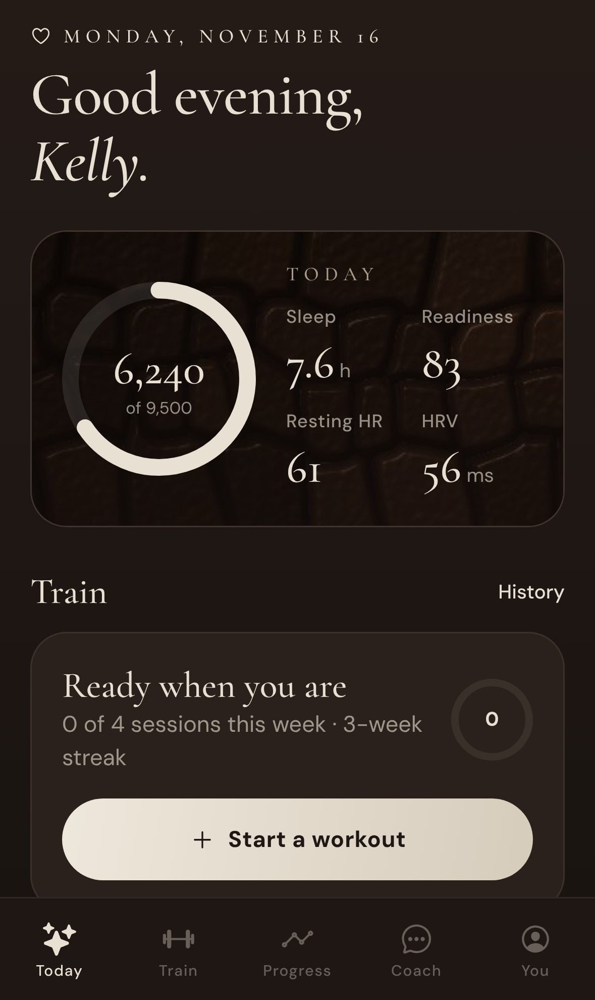
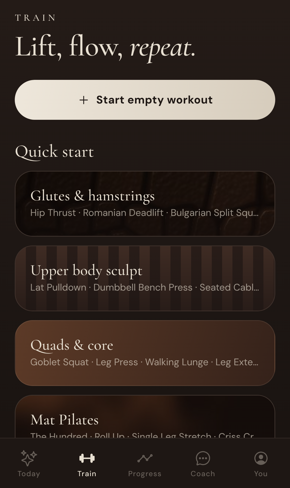
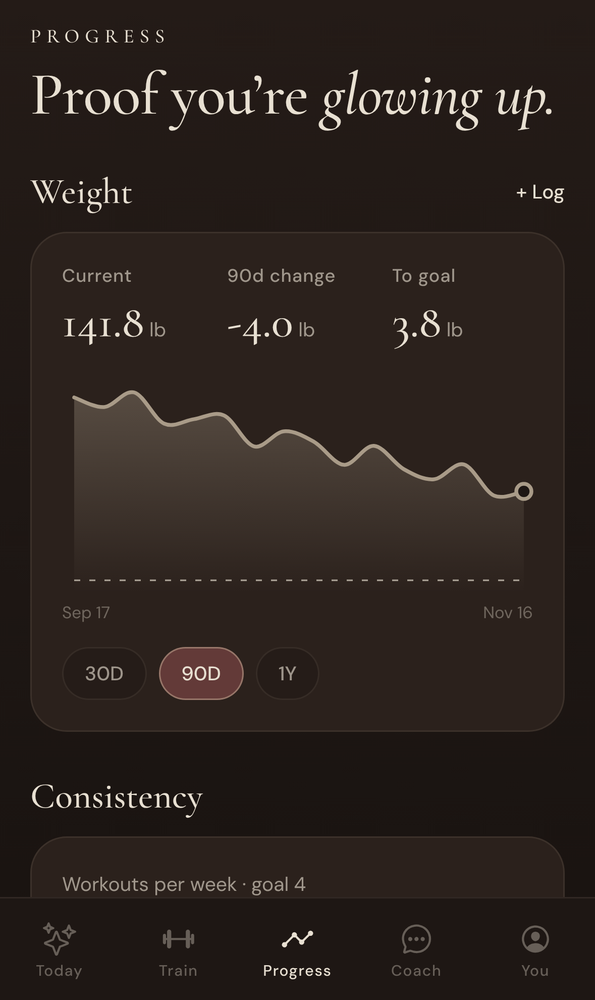
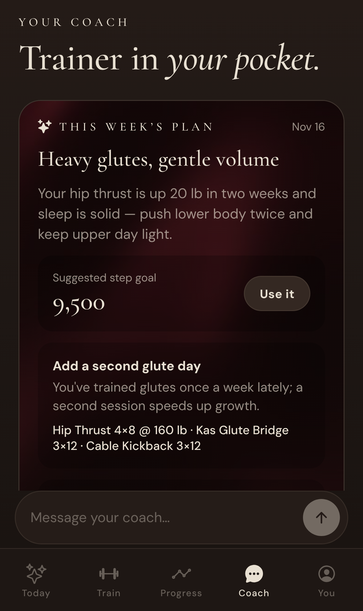

# rep.

A moody workout tracker in bone, espresso, burnt olive and oxide with a built-in AI personal trainer.

| Today | Train | Progress | Coach |
|---|---|---|---|
|  |  |  |  |

## What's in v1

- **Workout logging**: exercises, sets, reps and weight (or minutes/distance for cardio, seconds for holds). There are 90+ built-in exercises across strength, Pilates, mobility and cardio, plus custom ones. Last session's numbers prefill so you can see what to beat. Includes quick-start templates, a session timer, a "how did it feel" rating, history, and estimated 1RM personal records.
- **Body & goals**: goals, height, goal weight, weigh-ins, body fat, waist and hips, a weight trend chart with your goal line, and lb/ft-in ⇄ kg/cm switching.
- **Health data**:
  - **Apple Health**: steps, sleep, resting HR, HRV, active calories and weigh-ins.
  - **RingConn**: comes in through Apple Health. In the RingConn app, turn on Apple Health sync.
  - **Oura**: readiness, sleep score, HRV and steps, through Oura's official API.
- **AI coach (Claude)**: a weekly plan (focus, 3–4 recommendations with specific exercises, a step goal you can apply with one tap, and recovery advice) plus a chat that knows your goals, lifts and recovery data.

Everything is stored on your phone. The only things that leave it are what's sent to your own coach server when you use the AI coach, and the Oura sign-in.

## Project layout

```
app/                 screens (Expo Router)
  (tabs)/            Today, Train, Progress, Coach, You
  workout/[id].tsx   the live workout logger
src/
  store.ts           all app data (saved on device)
  coach.ts           builds the snapshot the AI coach reads
  health/            Apple Health, Oura, sync
  components/        UI kit + charts
  theme.ts           colours & fonts
server/              tiny Node server that holds your Claude key + Oura secret
assets/textures/     croc.jpg, tortoise.jpg, satin.jpg (replace any file to change that card texture)
```

## Setup

### 1. Run the coach server

The app never contains your API keys. They live on a small server you control.

```bash
cd server
npm install
cp .env.example .env    # then fill in ANTHROPIC_API_KEY and APP_TOKEN
npm run dev
```

- Get an Anthropic API key at console.anthropic.com.
- `APP_TOKEN` is any long random password. You'll type the same value into the app.
- To host it, any Node host works (Render, Railway, Fly.io). Use build command `npm install && npm run build`, start command `npm start`, root directory `server`, and set the same env variables there.

### 2. Run the app

```bash
npm install
npx expo start
```

Then in the app go to **You → Coach server** and enter the server URL and app password.

### 3. Put it on your iPhone (Apple Health needs a real build)

Apple Health and Oura sign-in don't work in Expo Go or the browser preview. You need a development build:

- **With a Mac + Xcode:** `npx expo run:ios --device` installs it for free with your Apple ID. Apple makes you reinstall every 7 days.
- **Without a Mac:** use `npx eas-cli@latest build --profile development --platform ios` (needs the $99/yr Apple Developer account).

### 4. (Optional) Connect Oura

1. Create an app at cloud.ouraring.com → *API Applications*. Redirect URI: `rep://oura`.
2. Put the client ID and secret in `server/.env` (`OURA_CLIENT_ID`, `OURA_CLIENT_SECRET`).
3. Create `.env` in the project root with `EXPO_PUBLIC_OURA_CLIENT_ID=<same client id>` and rebuild the app.
4. In the app: **You → Oura → Connect**.

## Status

- Typechecks clean. Every screen was clicked through in a phone-sized browser preview.
- The coach server was tested locally: password check, error handling, and a live call that reached Anthropic.
- **Not yet tested on a real iPhone**: Apple Health reads, Oura sign-in, and Oura data (written against Oura's v2 API docs). Expect a round of fixes on first device run.
